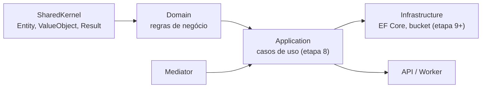
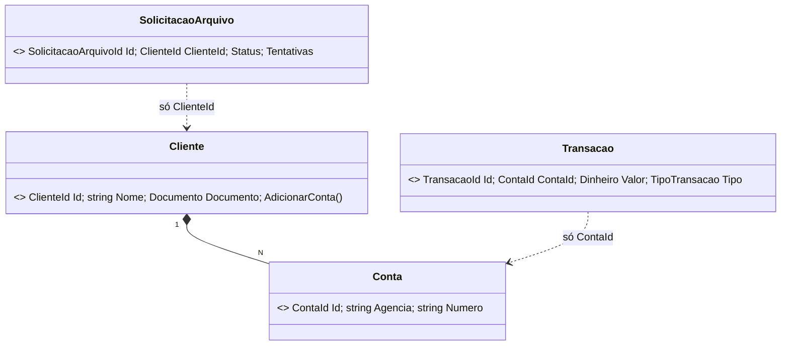
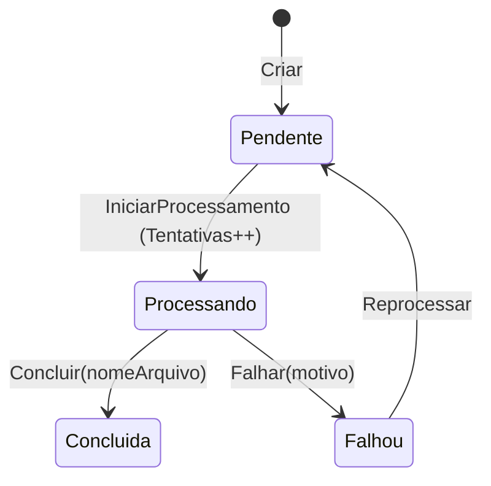
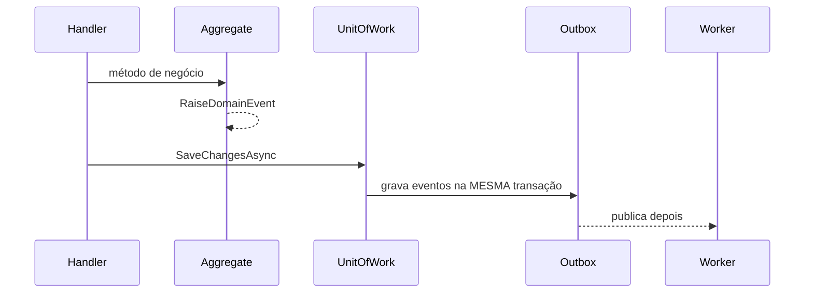
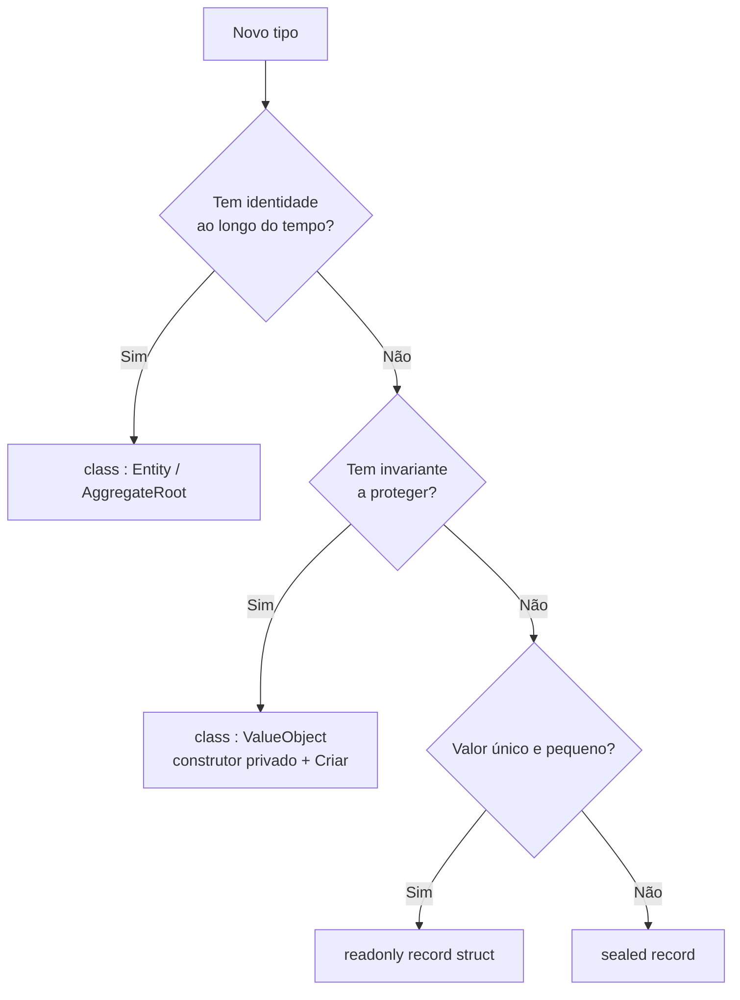

# 📘 Guia do Projeto FileForge — Decisões e Conceitos

> Documento **vivo**: explica *por que* o código é como é. A cada etapa nova, acrescente uma seção em
> [Histórico de decisões](#11-histórico-de-decisões-adr-resumido).
> O `README.md` diz **o que** é o projeto e o roadmap; este guia diz **por quê**.

## Sumário

1. [Visão geral da arquitetura](#1-visão-geral-da-arquitetura)
2. [DDD — a ideia central](#2-ddd--a-ideia-central)
3. [Os blocos táticos: Value Object, Entity, Aggregate](#3-os-blocos-táticos)
4. [Os aggregates do FileForge](#4-os-aggregates-do-fileforge)
5. [Domain Events](#5-domain-events)
6. [Tratamento de erros: Result × Exceção](#6-tratamento-de-erros-result--exceção)
7. [`record` × `class`: quando usar cada um](#7-record--class-quando-usar-cada-um)
8. [Mediator e Pipeline Behaviors](#8-mediator-e-pipeline-behaviors)
9. [Detalhes de código que parecem estranhos](#9-detalhes-de-código-que-parecem-estranhos)
10. [Testes: como rodar e debugar para estudar](#10-testes-como-rodar-e-debugar-para-estudar)
11. [Histórico de decisões](#11-histórico-de-decisões-adr-resumido)

---

## 1. Visão geral da arquitetura



| Projeto | Responsabilidade | Depende de |
|---|---|---|
| `FileForge.SharedKernel` | Peças genéricas de DDD (servem a qualquer domínio) | nada |
| `FileForge.Mediator` | Envio de commands/queries e publicação de notificações | DI da Microsoft |
| `FileForge.Domain` | Regras do negócio de extratos | **só** SharedKernel |
| `FileForge.Application` | Orquestra casos de uso (etapa 8) | Domain + Mediator |

**Regra de ouro:** as dependências apontam **para dentro**. O Domain não conhece banco, API, fila nem Mediator — por isso é testável sem subir nada.

---

## 2. DDD — a ideia central

### 2.1 O problema: modelo anêmico

```csharp
// ❌ Anêmico: só dados; qualquer um altera qualquer coisa
public class SolicitacaoArquivo
{
    public Guid Id { get; set; }
    public string Status { get; set; }
}

// a regra fica espalhada (e duplicada) em services, workers, controllers...
if (s.Status == "Pendente") s.Status = "Processando";
```

- Nada impede `s.Status = "Concluida"` direto de `Pendente`.
- A mesma regra é reescrita em vários lugares e diverge com o tempo.

### 2.2 A solução: o objeto protege a si mesmo

```csharp
// ✅ Rico: dados + regras juntos; o estado só muda por métodos com nome de negócio
public Result IniciarProcessamento(IDateTimeProvider relogio)
{
    if (Status != StatusSolicitacao.Pendente)
        return DomainErrors.SolicitacaoArquivo.TransicaoInvalida;
    Status = StatusSolicitacao.Processando;
    ...
}
```

> **Um objeto de domínio nunca existe em estado inválido.**

### 2.3 Estratégico × Tático

| Metade | O que é | No projeto |
|---|---|---|
| **Estratégico** | Entender o negócio: *linguagem ubíqua*, *bounded contexts* | Nomes do negócio em português: `SolicitacaoArquivo`, `Reprocessar`, `DataReferencia` |
| **Tático** | Padrões de código | Value Object, Entity, Aggregate, Domain Event, Repository |

**Linguagem ubíqua:** o código fala como o especialista. Se o analista diz *"a solicitação falhou e foi reprocessada"*, existe `Falhar()` e `Reprocessar()` — não `SetStatus(3)`.

### 2.4 Invariante

Regra que **sempre** precisa ser verdadeira. Garantir invariantes é o motivo de existir dos aggregates e value objects.

| Invariante | Quem garante | Como |
|---|---|---|
| Dinheiro nunca negativo | `Dinheiro` | `Criar` recusa |
| Data de referência não está no futuro | `DataReferencia` | `Criar` compara com `IDateTimeProvider` |
| Conta não duplicada no cliente | `Cliente` | só ele enxerga todas as contas |
| Transição de status válida | `SolicitacaoArquivo` | `private set` + métodos |
| Uma solicitação **ativa** por cliente/data | **Application** (+ índice único no banco) | envolve vários aggregates — ver §4.4 |

---

## 3. Os blocos táticos

| Conceito | Igualdade por | Muda ao longo do tempo? | Exemplos |
|---|---|---|---|
| **Value Object** | **valores** | não (imutável) | `Documento`, `Dinheiro`, `DataReferencia` |
| **Entity** | **Id** | sim | `Conta` |
| **Aggregate Root** | **Id** + é a porta de entrada | sim | `Cliente`, `Transacao`, `SolicitacaoArquivo` |

### 3.1 Value Object — "se existe, é válido"

```csharp
public sealed class Dinheiro : ValueObject
{
    private Dinheiro(decimal valor) => Valor = valor;        // construtor privado

    public static Result<Dinheiro> Criar(decimal valor) =>  // única porta de entrada
        valor < 0 ? DomainErrors.Dinheiro.Negativo
                  : new Dinheiro(Math.Round(valor, 2, MidpointRounding.AwayFromZero));

    public static Dinheiro operator +(Dinheiro a, Dinheiro b) => new(a.Valor + b.Valor); // nova instância
}
```

- Valida **uma vez**, na criação. Quem recebe um `Dinheiro` não precisa revalidar.
- Combate a *primitive obsession* (usar `string`/`decimal` para tudo e validar em todo lugar — ou em lugar nenhum).
- Igualdade definida por `GetEqualityComponents()` na base `ValueObject`.

### 3.2 IDs fortemente tipados

```csharp
public readonly record struct ClienteId(Guid Value);
```

Se tudo fosse `Guid`, `ObterTransacoes(solicitacaoId)` compilaria mesmo sendo um bug. Com tipos próprios, **o compilador impede a troca**.

### 3.3 Entity — identidade

Duas contas com a mesma agência/número continuam sendo contas diferentes se os Ids forem diferentes. A base `Entity<TId>` compara **só tipo + Id**.

### 3.4 Aggregate Root — a fronteira

- Única porta de entrada para alterar o que está dentro.
- Fronteira de **consistência** (o que precisa estar correto na mesma transação) e de **concorrência**.
- Acumula **Domain Events**.

---

## 4. Os aggregates do FileForge



### 4.1 Como decidir o tamanho de um aggregate

Não pergunte *"o que se relaciona com o quê?"*. Pergunte:

> **"Quais dados precisam estar consistentes na MESMA transação?"**

- **Conta duplicada** → preciso ver todas as contas ao mesmo tempo → `Conta` **dentro** de `Cliente`.
- **Transação** → registrar uma não depende de regra do cliente; e um cliente pode ter **milhões** → aggregate **separado**. Se ficasse dentro de `Cliente`, adicionar uma conta exigiria carregar milhões de linhas, e duas transações simultâneas brigariam pelo mesmo registro.

### 4.2 Regras aplicadas

| Regra | Código |
|---|---|
| Aggregates pequenos | `Transacao` separado de `Cliente` |
| Referência entre aggregates **só por Id** | `public ContaId ContaId` (nunca `public Conta Conta`) |
| Entidade filha só muda via root | `Conta.Criar` é `internal`; `Cliente.AdicionarConta` é `public` |
| Coleção não exposta para escrita | `private List<Conta> _contas` + `IReadOnlyCollection<Conta> Contas` |
| Um aggregate alterado por commit | será aplicado nos handlers (etapa 8) |

### 4.3 `SolicitacaoArquivo` — máquina de status



- `Status` tem `private set`: a **única** forma de mudar é pelos métodos.
- Transição inválida → `Result.Failure(TransicaoInvalida)` e **nada muda** (nem evento é gerado).
- `Ativa` = `Pendente` ou `Processando` → base da idempotência.

### 4.4 Regra que **não** cabe num aggregate

"Só uma solicitação ativa por cliente/data" envolve **várias** solicitações; um aggregate não enxerga os outros. Solução pragmática:

1. Handler consulta `ExisteAtivaAsync` antes de criar (Application).
2. Índice único no banco como rede de segurança contra corrida (etapa 9).

> Nem toda regra cabe num aggregate — e tudo bem.

---

## 5. Domain Events

```csharp
RaiseDomainEvent(new ArquivoGerado(Id, NomeArquivo));
```

- Fato **no passado** (`Criada`, `Iniciado`, `Gerado`, `Falhou`).
- O aggregate só **anota**; não sabe quem vai reagir (e-mail, fila, auditoria). Isso o mantém desacoplado.
- Eventos atuais: `SolicitacaoArquivoCriada`, `ProcessamentoIniciado`, `ArquivoGerado`, `ProcessamentoFalhou`.

Fluxo previsto (etapas 8–11):



**Outbox** resolve a *dupla escrita*: sem ele, poderíamos salvar no banco e cair antes de publicar na fila (ou o contrário).

---

## 6. Tratamento de erros: Result × Exceção

> **Exceção é para o excepcional. Falha de negócio esperada é resultado.**

| Situação | Exemplo | Tratamento |
|---|---|---|
| Regra de negócio | conta duplicada, data no futuro, transição inválida | `return DomainErrors.X;` → `Result.Failure` |
| Entrada inválida | `ClienteId` vazio | `ErrorType.Validation` (FluentValidation na etapa 8) |
| Bug do programador | `relogio` nulo, `TipoTransacao` = 99 | `throw` — corrige-se o código |
| Infra transitória | timeout no banco/bucket | exceção + Polly (etapa 12) |

Por que `Result`:
- A assinatura `Result<Cliente>` **avisa** que pode falhar; exceção é invisível.
- Exceção é cara e funciona como "goto invisível" quando usada para fluxo.
- `ErrorType` vira status HTTP na API: `Validation`→400, `NotFound`→404, `Conflict`→409.

**Catálogo `DomainErrors`**: todos os erros num lugar, com **código estável** (`Cliente.ContaDuplicada`). Testes comparam o erro exato; clientes da API podem depender do código.

**Conversões implícitas** permitem escrever:

```csharp
return DomainErrors.Cliente.NomeObrigatorio;   // Error → Result<Cliente> (falha)
return new Cliente(...);                       // Cliente → Result<Cliente> (sucesso)
```

---

## 7. `record` × `class`: quando usar cada um

### 7.1 O que `record` gera

Igualdade por valor, `ToString`, `with`, desconstrução, propriedades `init`.

### 7.2 Decisões no projeto

| Tipo | Escolha | Motivo |
|---|---|---|
| IDs (`ClienteId`...) | `readonly record struct` | valor único, igualdade grátis, sem alocação |
| `Error` | `sealed record` | dado imutável sem invariante |
| Domain Events | `sealed record` | fatos imutáveis |
| Commands/Queries/DTOs (etapa 8) | `sealed record` | mensagens imutáveis |
| `Documento`, `Dinheiro`, `DataReferencia` | `class : ValueObject` | **têm invariante** (ver 7.3) |
| `Cliente`, `Conta`, `Transacao`, `SolicitacaoArquivo` | `class : Entity/AggregateRoot` | identidade + mutáveis (ver 7.4) |

### 7.3 Armadilhas de usar `record` em Value Object com regra

```csharp
public sealed record Dinheiro(decimal Valor);
var d = new Dinheiro(-50m);              // ❌ construtor público burla a validação
var e = d with { Valor = -999m };        // ❌ "with" também burla
```

Mesmo com construtor privado, o `with` usa o construtor de cópia + `init`. Além disso, `record` compara `List<T>` **por referência**. Com `class : ValueObject`, a única porta é `Criar`.

> Demonstração executável: `IgualdadeEInvariantesTests.ArmadilhaDoRecord_ConstrutorPublicoEWithBurlamValidacao`.

### 7.4 Por que Entity **nunca** é `record`

- `record` compara **todos** os campos; entidade é igual pelo **Id**.
- Entidade é mutável por natureza; `record` é pensado para imutabilidade.
- O change tracker do EF Core depende de identidade estável.

### 7.5 Fluxograma de decisão



---

## 8. Mediator e Pipeline Behaviors

### 8.1 Por quê

Cada caso de uso vira uma **mensagem** com **um handler**:

```csharp
public sealed record CriarSolicitacaoCommand(Guid ClienteId, DateOnly Data) : IRequest<Result<Guid>>;
var result = await mediator.Send(new CriarSolicitacaoCommand(id, data), ct);
```

- Um caso de uso = um handler: fácil de achar e testar.
- Preocupações transversais (validação, log, transação, idempotência) escritas **uma vez** como behaviors.
- Controller fino; casa com **CQRS** (command altera, query lê).
- **Por que próprio e não MediatR?** Estudo + MediatR passou a ter licença comercial.

### 8.2 Contratos

| Interface | Papel |
|---|---|
| `IRequest<TResponse>` + `IRequestHandler<,>` | 1 mensagem → **exatamente 1** handler |
| `INotification` + `INotificationHandler<>` | 1 mensagem → **0..N** handlers |
| `ISender` / `IPublisher` / `IMediator` | ISP: depende só do que usa |
| `IPipelineBehavior<,>` | middleware em volta do handler |

### 8.3 Pipeline = cebola


```csharp
public async Task<TResponse> Handle(TRequest req, RequestHandlerDelegate<TResponse> next, CancellationToken ct)
{
    // antes
    var resp = await next();   // próximo behavior ou o handler
    // depois
    return resp;
}
```

Um behavior pode **não** chamar `next()` (ex.: validação falhou → retorna `Result.Failure`).

### 8.4 Como funciona por dentro

**Problema:** `Send` recebe `IRequest<TResponse>`, mas o DI precisa de `IRequestHandler<TRequest, TResponse>` — e `TRequest` só é conhecido em runtime.

**Solução:** wrapper genérico criado por reflection **uma vez por tipo** e cacheado em `ConcurrentDictionary`:

```csharp
RequestWrappers.GetOrAdd(request.GetType(), t =>
    Activator.CreateInstance(typeof(RequestHandlerWrapperImpl<,>).MakeGenericType(t, typeof(TResponse)))!);
```

Montagem do pipeline (em `RequestHandlerWrapper.cs`):

```csharp
RequestHandlerDelegate<TResponse> pipeline = () => handler.Handle(typedRequest, ct);
foreach (var behavior in behaviors.Reverse())
{
    var next = pipeline;   // captura obrigatória: sem ela a closure vira recursão infinita
    pipeline = () => behavior.Handle(typedRequest, next, ct);
}
```

- `.Reverse()`: monta de dentro para fora, então o **primeiro registrado** fica **mais externo**.
- `Publish`: se um handler falhar, os demais executam e as falhas são reunidas em `AggregateException`.
- Registro no DI é **idempotente** (`TryAdd*`): chamar `AddMediator` duas vezes não duplica handlers.

### 8.5 Domain não depende do Mediator

`IDomainEvent` (SharedKernel) ≠ `INotification` (Mediator). A ponte fica na Application:

```csharp
public sealed record DomainEventNotification(IDomainEvent Evento) : INotification;
```

> Demonstração executável: `CriarSolicitacaoFluxoTests.Publish_EventosDoAggregate_ChegamAosHandlersViaPonte`.

### 8.6 Críticas conhecidas

| Crítica | Resposta |
|---|---|
| Esconde dependências (F12 não leva ao handler) | Convenção `XCommand` → `XCommandHandler` |
| Indireção desnecessária em CRUD | O valor aqui está nos behaviors |
| Reflection é lenta | Só na 1ª chamada por tipo; depois cache |

---

## 9. Detalhes de código que parecem estranhos

| Código | Motivo |
|---|---|
| `private Cliente() { }` vazio | EF Core reconstrói o objeto do banco por ele; privado para ninguém usar |
| `IDateTimeProvider` em vez de `DateTime.UtcNow` | Teste determinístico ("futuro" não depende de quando o teste roda) |
| `static Criar(...)` em vez de `new` | Construtor não retorna `Result`; o método estático pode falhar sem exceção |
| `sealed` nas classes | Não foram desenhadas para herança; evita uso inesperado |
| `ValorComSinal` | Valor sempre positivo; o **tipo** dá o sinal (evita "débito de -50") |
| `Math.Round(..., AwayFromZero)` | Padrão monetário (10,125 → 10,13); o default do .NET é arredondamento bancário |

---

## 10. Testes: como rodar e debugar para estudar

### 10.1 Projetos

| Projeto | Tipo | O que cobre |
|---|---|---|
| `FileForge.SharedKernel.UnitTests` | unitário | `Result`, `Map/Bind/Match` |
| `FileForge.Mediator.UnitTests` | unitário | Send, Publish, pipeline, DI |
| `FileForge.Domain.UnitTests` | unitário | Value Objects, aggregates, máquina de status |
| `FileForge.Domain.UnitTests/Estudo` | **didático** | demonstra os conceitos deste guia |
| `FileForge.IntegrationTests` | integração | DI real + Mediator + Behavior + Domain juntos |

> Integração **hoje** = componentes reais conectados via DI, com repositório em memória.
> Na etapa 17 ganhará banco real com **Testcontainers**.

### 10.2 Rodar

```powershell
dotnet test                                                  # tudo
dotnet test tests/FileForge.Domain.UnitTests                 # só domínio
dotnet test --filter "FullyQualifiedName~Estudo"             # só os didáticos
dotnet test --filter "FullyQualifiedName~IntegrationTests"   # só integração
```

No Visual Studio: **Test Explorer** (`Ctrl+E, T`) → botão direito no teste → **Debug**.

### 10.3 Roteiro de estudo com breakpoints

| # | Arquivo / teste | Onde colocar breakpoint | O que observar |
|---|---|---|---|
| 1 | `Estudo/IgualdadeEInvariantesTests` → `ValueObject_DuasInstancias...` | `ValueObject.Equals` | comparação pelos componentes |
| 2 | `Estudo/...` → `Entity_MesmosDados_IdsDiferentes...` | `Entity<TId>.Equals` | comparação só pelo Id |
| 3 | `Estudo/...` → `ArmadilhaDoRecord...` | linha do `with` | o record aceita valor inválido |
| 4 | `Aggregates/ClienteTests` → `AdicionarConta_Duplicada...` | `Cliente.AdicionarConta` | invariante protegida pelo root |
| 5 | `Aggregates/SolicitacaoArquivoTests` → `Falhar_EReprocessar...` | cada método de transição | status, `Tentativas`, eventos |
| 6 | `IntegrationTests` → `Send_ComandoValido...` | `Mediator.Send`, `RequestHandlerWrapperImpl.Handle`, `RastreamentoBehavior`, `CriarSolicitacaoHandler` | caminho completo da "cebola" |
| 7 | `IntegrationTests` → `Send_MesmoClienteEData...` | `CriarSolicitacaoHandler` (`ExisteAtiva`) | regra entre aggregates na Application |
| 8 | `IntegrationTests` → `Publish_EventosDoAggregate...` | `AuditoriaHandler.Handle` | ponte Domain Event → Notification |

### 10.4 Exercícios (tente quebrar as regras)

1. Tente criar `Dinheiro` negativo sem usar `Criar`. Não compila? Ótimo — é o objetivo.
2. Tente fazer `cliente.Contas.Add(...)`. Por que não existe?
3. Mude `Conta.Criar` para `public` e escreva um teste que burla a regra de duplicidade. Depois desfaça.
4. Registre um segundo behavior no teste de integração e veja a ordem em `Rastro.Passos`.
5. Remova `var next = pipeline;` no wrapper e rode os testes do Mediator. Entenda o estouro.

---

## 11. Histórico de decisões (ADR resumido)

> Formato: **contexto → decisão → consequência**. Acrescente novas entradas no fim.

| # | Etapa | Decisão | Por quê | Consequência |
|---|---|---|---|---|
| 1 | 1 | SharedKernel separado | peças de DDD são genéricas | reutilizável, Domain fica enxuto |
| 2 | 2 | Mediator próprio | estudo + licença do MediatR | precisamos manter e testar |
| 3 | 4 | `Publish` com wrapper cacheado e `AggregateException` | sem reflection por chamada; falha isolada | todos os handlers rodam |
| 4 | 4 | DI idempotente (`TryAdd*`) | evitar handlers duplicados | `AddMediator` seguro de chamar 2x |
| 5 | 5 | Result para negócio, exceção para bug/infra | falha esperada deve ser explícita | assinaturas honestas, ProblemDetails na API |
| 6 | 5 | `Transacao` é aggregate próprio | volume e concorrência | referência por `ContaId` |
| 7 | 5 | `SolicitacaoArquivo` é o centro | idempotência, status, eventos | máquina de status no aggregate |
| 8 | 5 | Domain não depende do Mediator | Domain puro | ponte `DomainEventNotification` na Application |
| 9 | 6 | VO com regra = `class : ValueObject`; IDs = `record struct` | `record` permite burlar invariantes | só `Criar` constrói VO |
| 10 | 6 | Catálogo `DomainErrors` | códigos estáveis e testáveis | um lugar para todos os erros |
| 11 | 6 | Conversão implícita `Error → Result` | menos ruído no domínio | `return DomainErrors.X;` |
| 12 | 6 | `IDateTimeProvider` no domínio | testes determinísticos | relógio injetado nos métodos |
| 13 | 6 | Unicidade de solicitação ativa fica na Application | envolve vários aggregates | + índice único na etapa 9 |
| 14 | 6 | Projeto `FileForge.IntegrationTests` | ver as peças juntas e debugar | protótipo de handler; vira Testcontainers na etapa 17 |
| 15 | Review | `IDateTimeProvider.Hoje` no fuso do negócio (São Paulo) | às 22h em SP, em UTC já é amanhã: "data no futuro" era aceita | regras de calendário usam `Hoje`; `UtcNow` só para registrar instantes |
| 16 | Review | `DomainEvent` recebe `OccurredOnUtc` no construtor | ele lia `DateTime.UtcNow`, contrariando a decisão 12 | eventos determinísticos nos testes |
| 17 | Review | Validar todas as entradas **antes** de alterar o estado | exceção no meio deixava o aggregate pela metade | métodos começam com guardas, depois mutam |
| 18 | Review | `Publish` não agrega cancelamento; 1 falha = exceção original | cancelamento ficava escondido em `AggregateException` | `catch` específico para `OperationCanceledException` |
| 19 | Review | Dois handlers para o mesmo request = erro na inicialização | `TryAdd` descartava o segundo sem avisar | falha rápida (*fail fast*) na configuração do DI |
| 20 | Review | Todos os arquivos em UTF-8 | acentos quebrados em 2 arquivos | `.editorconfig` com `charset = utf-8` |

<!-- Próximas entradas: Etapa 7 (repositórios + Unit of Work) ... -->
