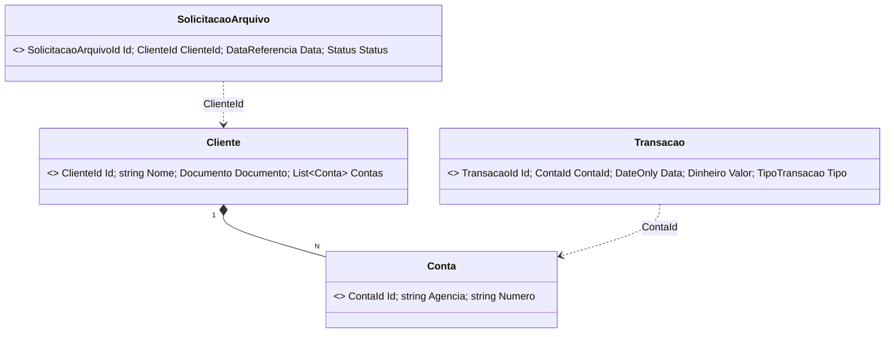

# FileForge

[](https://github.com/ronanmuller/FileForge/actions/workflows/ci.yml)


> Projeto de **estudos** em .NET 9. Não é um projeto de empresa e não tem levantamento formal de requisitos: o objetivo é aplicar, **por etapas e entendendo cada decisão**, as melhores práticas de arquitetura, design patterns e ferramentas de mercado.

---

## 🤝 Forma de trabalho (leia antes de continuar)

1. **Etapas pequenas**: discutir → decidir → implementar → testar → atualizar este README.
2. **Nada de gerar código em massa**: cada etapa precisa ser entendida antes da próxima.
3. **Mudanças estruturais** (`.sln`, `.csproj`, criar/excluir projetos ou pastas) só com confirmação prévia, agrupadas em uma única vez (evita recarregamentos do Visual Studio).
4. **Verificar o que já existe** antes de criar qualquer coisa.
5. **Confirmar que os arquivos foram gravados** e que `dotnet test` passa antes de dar uma etapa como concluída.
6. Este README é a **fonte de verdade** do contexto do projeto. Atualize o roadmap e o diário a cada etapa.

---

## 🎯 Objetivo

1. Receber uma **solicitação** com `ClienteId` + `DataReferencia`;
2. **Buscar** as transações do cliente (via **Repository**);
3. **Processar** os dados (validações, agregações, totais);
4. **Gerar um arquivo sequencial** (layout posicional/fixed-width, estilo CNAB: header, detalhes, trailer);
5. **Enviar o arquivo para um bucket** (S3/MinIO ou Azure Blob/Azurite);
6. Publicar um evento de conclusão.

O processamento é **assíncrono**: a API aceita o pedido (`202 Accepted`) e workers processam em background.

```
Cliente ──► API ──► (Outbox) ──► Broker ──► Worker ──► Repositórios (SQL/NoSQL) ──► Gerador de Arquivo ──► Bucket
                │                                 │
                └──► Redis (idempotência/cache)   └──► Evento "ArquivoGerado"
```

---

## 🏦 Domínio fictício: Extrato de Transações Financeiras

### Linguagem ubíqua

| Termo | Significado |
|---|---|
| **Cliente** | Titular das contas. Identificado por `ClienteId`. |
| **Conta** | Conta do cliente (agência + número). |
| **Transação** | Movimento financeiro (crédito/débito) em uma conta, em uma data. |
| **Solicitação de Arquivo** | Pedido para gerar o extrato de um cliente em uma data de referência. |
| **Arquivo de Extrato** | Arquivo sequencial gerado (header + detalhes + trailer) e enviado ao bucket. |

### Aggregates (decidido)

| Aggregate Root | Contém | Observação |
|---|---|---|
| `Cliente` | `Conta` (entity) | Regra: não permitir conta duplicada (agência + número). |
| `Transacao` | — | **Aggregate próprio**, referencia `ContaId` por ID. Um cliente pode ter milhões de transações; colocá-las dentro de `Cliente` seria inviável (carga e concorrência). |
| `SolicitacaoArquivo` | — | **Centro do domínio**: unicidade por cliente/data, máquina de status, eventos. Referencia `ClienteId` por ID. |

Regras de DDD adotadas:
- **Aggregates pequenos** (Vaughn Vernon): um aggregate protege só as invariantes que precisam ser consistentes na mesma transação.
- **Referência entre aggregates somente por ID**, nunca pelo objeto.
- **Um aggregate alterado por commit.**

**Value Objects**: `ClienteId`, `ContaId`, `TransacaoId`, `SolicitacaoArquivoId`, `Documento` (CPF/CNPJ), `Dinheiro`, `DataReferencia`, `TipoTransacao`, `NomeArquivo`.

**Domain Events**: `SolicitacaoArquivoCriada`, `ProcessamentoIniciado`, `ArquivoGerado`, `ProcessamentoFalhou`.



### Invariantes

- Só pode existir **uma solicitação ativa** por `ClienteId + DataReferencia` (base da idempotência).
- `DataReferencia` não pode estar no futuro.
- Transições de status: `Pendente → Processando → Concluida | Falhou` (e `Falhou → Pendente` para reprocessar).
- Valores monetários nunca negativos; o sinal é dado pelo `TipoTransacao` (Crédito/Débito).

### Repository Pattern

- **Um repositório por Aggregate Root** (nunca por entidade filha): `IClienteRepository`, `ITransacaoRepository`, `ISolicitacaoArquivoRepository`.
- **Interfaces no Domain**, **implementações na Infrastructure** (EF Core / MongoDB) → Inversão de Dependência (o "D" do SOLID).
- O repositório **não faz commit**: quem confirma é o **Unit of Work** (`IUnitOfWork.SaveChangesAsync`).
- Leitura em massa para o arquivo via **streaming** (`IAsyncEnumerable<Transacao>`), sem carregar tudo em memória.

```csharp
public interface ISolicitacaoArquivoRepository
{
    Task<SolicitacaoArquivo?> ObterPorIdAsync(SolicitacaoArquivoId id, CancellationToken ct);
    Task<bool> ExisteAtivaAsync(ClienteId clienteId, DataReferencia data, CancellationToken ct);
    void Adicionar(SolicitacaoArquivo solicitacao);
}

public interface ITransacaoRepository
{
    IAsyncEnumerable<Transacao> ListarPorClienteEDataAsync(ClienteId clienteId, DataReferencia data, CancellationToken ct);
}
```

> Contratos definidos na etapa 7. `ITransacaoRepository` recebe `ContaId`s (ver GUIA §8.10).

---

## ⚠️ Tratamento de erros (decidido)

**Exceção é para o excepcional; falha de negócio esperada é resultado.**

| Tipo de falha | Exemplo | Tratamento |
|---|---|---|
| Regra de negócio | Solicitação já ativa, data no futuro | `Result.Failure(Error)` |
| Entrada inválida | `ClienteId` vazio | Validação (FluentValidation em behavior) → `ErrorType.Validation` |
| Bug | `null` inesperado, estado impossível | Exceção (`ArgumentNullException`, `InvalidOperationException`) — corrige-se o código |
| Infra transitória | Timeout no banco/bucket | Exceção + **Polly** (retry, circuit breaker) |
| Infra persistente | Mensagem que sempre falha | Exceção → retries limitados → **dead-letter queue** |

| Camada | Regra |
|---|---|
| Domain | VOs com construtor privado + fábrica `Criar(...)` → `Result<T>`. Métodos do aggregate retornam `Result`. Exceção só para bug. |
| Application | Encadeia `Result`s (`Bind`/`Map`); nunca faz `catch` genérico. |
| Infrastructure | Deixa a exceção subir; Polly trata as transitórias; sem `catch` só para logar. |
| API | `IExceptionHandler` global → **ProblemDetails** (RFC 9457) 500 sem detalhes internos. `Result` com falha → ProblemDetails: Validation→400, NotFound→404, Conflict→409. |
| Worker | Exceção → retry → dead-letter. Falha de negócio → solicitação `Falhou` + evento. |

Complementos:
- **Catálogo de erros por aggregate**: `SolicitacaoArquivoErrors.JaExisteAtiva` (códigos consistentes e testáveis).
- **Logar uma única vez**, na borda (API/Worker).
- `throw;` e nunca `throw ex;`.
- **Resolvido na etapa 8**: `ValidationError` agrupa vários erros de validação num único `Error`.

---

## 🧱 Princípios e práticas

| Tema | O que aplicar |
|---|---|
| Arquitetura | Clean Architecture, DDD, Vertical Slices na Application |
| Código | Clean Code, SOLID, CQRS |
| Mediator | **Próprio** (`FileForge.Mediator`), sem MediatR, com Pipeline Behaviors |
| Erros | **Result Pattern** (`Result`/`Result<T>` + `Map`/`Bind`/`Match`) |
| Persistência | **Repository**, **Unit of Work**, EF Core (SQL), MongoDB (NoSQL) |
| Mensageria | **Outbox**, consumidor idempotente, RabbitMQ (ou Kafka) |
| Idempotência | `Idempotency-Key` na API + chave natural (`ClienteId + Data`) + Redis/locks |
| Resiliência | **Polly** via `Microsoft.Extensions.Http.Resilience` |
| Cache | **Redis** |
| Observabilidade | **OpenTelemetry**, Serilog, Health Checks |
| Escalabilidade | Workers stateless, streaming (`IAsyncEnumerable`), backpressure com `Channels` |
| Testes | xUnit, Testcontainers, NetArchTest |
| Infra | Docker Compose, **.NET Aspire**, GitHub Actions |
| Padrão de código | `.editorconfig` (UTF-8, namespaces file-scoped, `_camelCase` em campos privados) |

### Convenção de idioma

- **Domínio** em **português** (linguagem ubíqua): `SolicitacaoArquivo`, `Transacao`, `ObterPorIdAsync`.
- **Infraestrutura técnica/genérica** em **inglês**: `Entity`, `AggregateRoot`, `Result`, `IMediator`, `IUnitOfWork`.
- Comentários, mensagens de erro e nomes de testes em **português**.

---

## 📁 Estrutura

```
src/
  BuildingBlocks/
    FileForge.SharedKernel      ✅ Entity, AggregateRoot, ValueObject, DomainEvent, Result (+ Map/Bind/Match), IUnitOfWork, IDateTimeProvider
    FileForge.Mediator          ✅ IMediator (ISender/IPublisher), IRequest, INotification, IPipelineBehavior, DI
  Core/
    FileForge.Domain            🚧 referencia SharedKernel (NÃO referencia Mediator)
    FileForge.Application       ✅ casos de uso (Criar/Obter/Reprocessar), behaviors (Logging, Autorização, Validação), IUsuarioAtual, IEventBus
  FileForge.Infrastructure      ⏳
  FileForge.Api                 ⏳
  FileForge.Worker              ⏳
  FileForge.AppHost             ⏳ .NET Aspire
tests/
  FileForge.Mediator.UnitTests      ✅
  FileForge.SharedKernel.UnitTests  ✅
  FileForge.Domain.UnitTests        🚧
```

---

> 📘 Para entender **por que** o código é assim, leia o [GUIA-DO-PROJETO.md](GUIA-DO-PROJETO.md).

## 🗺️ Roadmap

- [x] Etapa 1 — SharedKernel
- [x] Etapa 2 — Mediator próprio com pipeline behaviors
- [x] Etapa 3 — Testes do Mediator e do Result
- [x] Etapa 4 — Correções de qualidade (UTF-8, `Publish` sem reflection por chamada, DI idempotente, `Map/Bind/Match`, `IUnitOfWork` em arquivo próprio, `.editorconfig`)
- [x] Etapa 5 — Modelagem do domínio e decisão de tratamento de erros
- [x] Etapa 6 — Domain com TDD
  - [x] 6.1 Value Objects
  - [x] 6.2 Aggregate `Cliente` + `Conta`
  - [x] 6.3 Aggregate `Transacao`
  - [x] 6.4 Aggregate `SolicitacaoArquivo` (status + eventos)
- [x] Etapa 7 — Interfaces de repositório + Unit of Work
- [x] Etapa 8 — Application: commands/queries, `ValidationError`, `IUsuarioAtual` + `AuthorizationBehavior`, `IEventBus`
- [ ] Etapa 9 — Infrastructure: EF Core + PostgreSQL + repositórios + Outbox
- [ ] Etapa 10 — .NET Aspire AppHost (Postgres, RabbitMQ, Keycloak) + API (idempotência, ProblemDetails, Scalar)
  - [ ] 10.1 JWT com Keycloak: realm importado, policies por permissão, autorização por recurso (IDOR)
  - [ ] 10.2 Segurança da borda: scopes × roles, HTTPS, CORS restrito, cabeçalhos de segurança, **rate limiting**, segredos fora do código
  - [ ] 10.3 Proteção de dados: **mascaramento de CPF/CNPJ** em logs e respostas (LGPD)
- [ ] Etapa 11 — Worker + RabbitMQ: consumidor idempotente, retry, dead-letter, simulação de falhas, comandos no dashboard
- [ ] Etapa 12 — Geração do arquivo sequencial + Bucket (MinIO/Azurite) + Polly
  - [ ] 12.1 **Integridade**: SHA-256 do arquivo (`ChecksumArquivo` no `SolicitacaoArquivo`, no evento, no trailer e no bucket; verificação no download)
  - [ ] 12.2 (opcional) Webhook de "arquivo gerado" assinado com **HMAC-SHA256** (timestamp + anti-replay)
- [ ] Etapa 13 — Redis: cache do status, Pub/Sub + endpoint SSE de acompanhamento em tempo real
  - [ ] 13.1 **Idempotência moderna**: `Idempotency-Key` com lock atômico no Redis (`SET NX` + TTL + token de dono), resposta guardada, SHA-256 do corpo (422 se mudar), 409 se ainda em processamento
  - [ ] 13.2 Resiliência: se o Redis cair, a garantia continua no banco (índice único + `INSERT ... ON CONFLICT`)
- [ ] Etapa 14 — MongoDB: projeção da timeline do pedido (histórico tipo rastreio de e-commerce)
  - [ ] 14.1 (opcional) Event Sourcing com Marten para `SolicitacaoArquivo`
- [ ] Etapa 15 — OpenTelemetry completo + Health Checks
- [ ] Etapa 16 — Testcontainers (testes de arquitetura ✅ antecipados)
- [x] Etapa 17 — CI (GitHub Actions) ✅ antecipado

---

## 📝 Diário de decisões

- **Mediator próprio**: para estudar o padrão (e porque o MediatR passou a ter licença comercial).
- **Result Pattern** para negócio; exceções para bug/infra; ProblemDetails na API.
- **Assíncrono por padrão**: a API apenas registra a intenção.
- **`Publish` com wrapper cacheado**: se um handler falhar, os demais executam e as falhas são reunidas em `AggregateException`.
- **Registro no DI idempotente** (`TryAdd*`).
- **Domínio fictício**: extrato de transações financeiras, arquivo estilo CNAB.
- **`Transacao` é aggregate próprio** (completo, para estudo), com referência por ID.
- **`SolicitacaoArquivo` é o centro do domínio**.
- **Repository por Aggregate Root**, sem commit próprio (Unit of Work).
- **Domain não depende do Mediator**: eventos usam `IDomainEvent` do SharedKernel; a ponte fica na Application.
- **Estrutura de pastas**: `src/BuildingBlocks` (genérico) e `src/Core` (Domain/Application).
